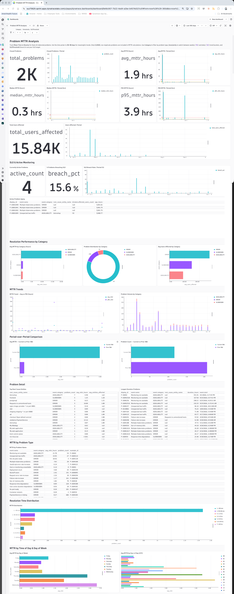

# Problem MTTR Analysis — Dynatrace Dashboard

A ready-to-deploy Dynatrace dashboard for tracking **Mean Time to Resolve** (MTTR) for Davis AI-detected problems. Works on any Dynatrace SaaS environment with Grail. No configuration required — deploy and open.



## What It Shows

### KPI Pairs (top of dashboard)
Each metric shows a headline number alongside its trend bar chart. Two pairs per row so you can compare related metrics side by side.

| Tile | What it measures |
|------|-----------------|
| **Closed Problems** | Total resolved problems in the selected timeframe |
| **Avg MTTR** | Mean resolution time across all closed problems (hours) |
| **Median MTTR** | 50th-percentile resolution time — less affected by outliers than avg |
| **P95 MTTR** | 95th-percentile — your worst-case resolution time |
| **Total Users Affected** | Sum of `dt.davis.affected_users_count` across all closed problems |

Each paired bar chart uses the **Granularity** variable (`7d` or `1d`) so you can zoom in or out. Threshold reference lines on the bar charts mark good/amber/bad zones.

---

### SLO & Active Monitoring
Forward-looking section — the only part of the dashboard that reflects problems happening *right now*.

| Tile | What it measures |
|------|-----------------|
| **Currently Active Problems** | Count of open (non-duplicate) problems right now |
| **% Problems Breaching SLO** | Fraction of closed problems that exceeded the **SLOThreshold** variable |
| **SLO Breach Rate / Period** | Bar chart of SLO breach % over time — shows whether compliance is improving |
| **Active Problem Aging** | Table of all open problems sorted by how long they've been open (`age_hours`) |

> **Demo tip:** Any row in the Active Problem Aging table approaching your SLO threshold is a live conversation starter. Set `SLOThreshold` to the customer's stated SLO (e.g. `4` for a 4-hour target) before the meeting.

---

### Resolution Performance by Category
Breaks down MTTR and volume across the five Davis problem categories.

| Tile | What it measures |
|------|-----------------|
| **Avg MTTR by Category** | Horizontal bar chart — which categories take longest to resolve |
| **Problem Distribution** | Donut chart — relative volume of each category |
| **Avg Users Affected by Category** | Which categories have the highest user impact per problem |

---

### MTTR Trends
Time-series views for spotting directional change.

| Tile | What it measures |
|------|-----------------|
| **MTTR Trend — Avg vs P95** | Line chart overlaying avg and P95 — narrowing gap = fewer long-tail incidents |
| **Problem Volume by Category** | Stacked bar chart showing problem creation rate by category over time |

---

### Period-over-Period Comparison
Explicitly answers *"are we getting better?"* by comparing the last 30 days to the prior 30 days. This section ignores the dashboard time picker — it always looks at the fixed 60-day window so the comparison is apples-to-apples.

| Tile | What it measures |
|------|-----------------|
| **Avg MTTR — Current vs Prior 30d** | Side-by-side bar: taller current bar = resolution is slowing |
| **Problem Count — Current vs Prior 30d** | Side-by-side bar: taller current bar = more incidents being detected |

---

### Problem Detail
Drill-down tables for identifying where to focus remediation effort.

| Tile | What it measures |
|------|-----------------|
| **Top Root Cause Entities** | Ranked by problem frequency; includes avg MTTR and avg blast radius (affected entities) |
| **Longest Duration Problems** | Individual outliers that skew overall MTTR — start here when P95 >> Avg |

---

### MTTR by Problem Type
Table aggregated by `event.name` (problem title). Shows which problem types are hardest to resolve vs. most frequent. The `example_id` column links to a representative problem for investigation.

---

### Resolution Time Distribution
Bucketed histogram showing how problems are distributed across resolution time ranges:

`<30 min` · `30–60 min` · `1–2 hrs` · `2–4 hrs` · `4–8 hrs` · `8–24 hrs` · `>24 hrs`

A healthy environment has most volume in the first two buckets with a long right tail. If `4–8 hrs` or `>24 hrs` dominates, that's where improvement efforts will have the highest impact.

---

### MTTR by Time of Day & Day of Week
Staffing gap analysis — identifies whether specific hours or days consistently produce higher MTTR.

| Tile | What it measures |
|------|-----------------|
| **Avg MTTR by Day of Week** | Which days have the slowest resolution |
| **Avg MTTR by Hour of Day (UTC)** | Which hours have the slowest resolution |

> **Note:** Times are UTC. Adjust for the customer's primary timezone when interpreting results. A spike at 02:00 UTC on weekdays often means an overnight issue with no on-call coverage.

---

## Variables

| Variable | Values | Purpose |
|----------|--------|---------|
| `Category` | `AVAILABILITY`, `ERROR`, `SLOWDOWN`, `RESOURCE`, `CUSTOM` | Multi-select filter — defaults to all |
| `Granularity` | `7d`, `1d` | Bucketing interval for all trend bar charts |
| `SLOThreshold` | `1`, `2`, `4`, `8`, `24` (hours) | Sets the breach threshold for the SLO tiles |

## Problem Categories

Davis AI uses these `event.category` values:

| Category | Triggered by |
|----------|-------------|
| `AVAILABILITY` | Service unreachable, synthetic test failures, connection lost |
| `ERROR` | Increased error rates beyond baseline |
| `SLOWDOWN` | Response time degradation |
| `RESOURCE` | CPU, memory, or disk saturation |
| `CUSTOM` | Custom anomaly detection rules |

## Prerequisites

- [`dtctl`](https://github.com/nicholasgoss-dynatrace/dt-ai-obs-utils) CLI installed and configured with a target environment context

## Deploy

```bash
dtctl apply -f dashboard.json -o yaml
```

The output includes the dashboard URL. **Do not use the Dynatrace console import** — it strips the document schema and produces a blank dashboard.

## Update an Existing Deployment

```bash
# 1. Get the current live version (preserves any UI edits)
dtctl get dashboard <your-dashboard-id> -o json --plain > current.json

# 2. Merge changes from dashboard.json, then redeploy:
dtctl apply -f current.json -o yaml
```

## Tips for SEs

- **No data?** Set the time picker to cover a period with closed problems. Sprint demo environments often need a 90–365 day range.

- **Median shows 0.0?** This was a known bug — resolved. All duration calculations now use `toDouble()` before the nanosecond-to-hours conversion to avoid integer truncation. If you see it again, check whether the query omits `toDouble()`.

- **Interpreting P95 vs Avg:** A large gap means a small number of very long incidents are pulling the average up. Open the "Longest Duration Problems" table to find them.

- **SLO conversation starter:** Set `SLOThreshold` to the customer's stated target, then point to the breach rate trend. A downward-sloping breach rate bar chart is the cleanest possible MTTR success story.

- **Period-over-Period is time-picker independent:** It always compares last 30 days vs prior 30 days. If a customer set the time picker to "last 7 days" for other tiles, these bars still show the full 30/30 comparison — explain that to avoid confusion.

- **Active Problem Aging table:** This table is not filtered by the time picker — it shows ALL currently active problems regardless of when they started. This is intentional.

- **Root cause entities:** The "Top Root Cause Entities" tile works best on tenants where Davis has had time to map Smartscape topology — typically a few days of data collection with OneAgent deployed.

- **Time-of-day charts are UTC:** Convert to local time before presenting. A spike at hour `02` for a US East customer = 10 PM the prior evening.